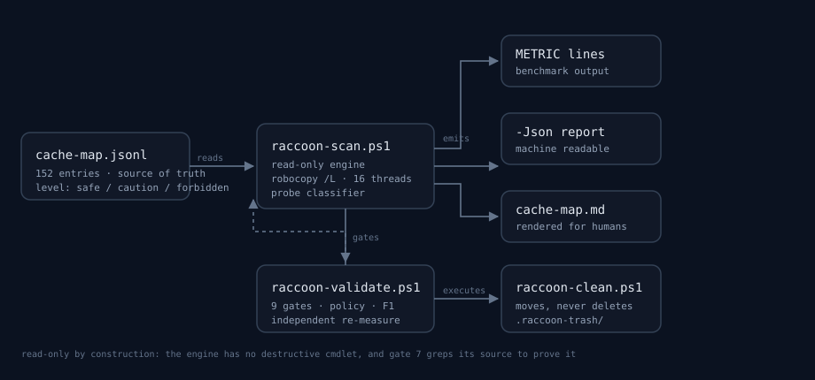

<div align="center">


<h1>win-raccoon · 小浣熊 Win 版</h1>

<a href="#-30-秒上手"></a>

**浣熊吃东西之前，会先洗一洗。你删文件之前，先跑体检。**

<p>


</p>

</div>

---

## 🎯 它是什么

一个**只读**的 Windows 缓存审计工具。它把「哪些目录可以删、哪些碰了就丢数据」写成一份机器可读的地图，对着你的机器实测每个路径的真实体积，按三级安全等级分类，然后——**在你确认之前，一个字节都不动**。

不是清理软件。清理软件让你点「一键优化」，然后你永远不知道它删了什么。这个工具先给你证据，再给你选择。

## 💢 为什么需要它

C 盘满了，你打开资源管理器，看到 `AppData` 里几十个不认识的目录，每个都占几个 G。你不知道：

- `pnpm/store` 是缓存还是你的项目依赖？——**都不是**，真正的 store 叫 `pnpm/package-manager-store`，写错路径的清理脚本会删掉你的依赖树。
- `DingTalk/log` 能删吗？——**没有这个目录**，真实路径是 `holmeslogs` / `recordLog` / `updaterlogs`。
- `D:/temp` 听起来像临时文件？——这台机器上它装着 **14.5 GB 的活项目**。

手写的清理清单不可验证，抄来的路径经常是错的。所以这里的地图是**实测出来的**，每一条都带 `source` 和 `evidence`，并且由 9 道闸门在每次改动后重新验证。

## ⚡ 30 秒上手

```powershell
git clone https://github.com/flying-dragon-ai/win-raccoon-lab.git
cd win-raccoon-lab

# 1. 体检：只读，不动任何文件
powershell -File tools/raccoon-scan.ps1 -Top 10

# 2. 过闸门：9 项检查，确认地图本身是安全的
powershell -File tools/raccoon-validate.ps1

# 3. 看清理清单（DryRun 不移动任何东西）
powershell -File tools/raccoon-clean.ps1 -DryRun
```

没有依赖，没有安装步骤，没有管理员权限要求（部分系统级路径需要，脚本会标出来）。

## 📟 输出长什么样

```text
METRIC safe_gb=17.463
METRIC caution_gb=18.124
METRIC forbidden_gb=42.797
METRIC entries=152
METRIC present=84
METRIC missing=68
METRIC scan_seconds=6.94

--- top 6 by bytes ---
  13,427.1 MB  forbidden C:\Users\Administrator\Downloads
   7,762.7 MB  safe      C:\Users\Administrator\AppData\Local\Temp
   6,211.0 MB  forbidden C:\Windows\WinSxS
   4,440.8 MB  forbidden C:\Users\Administrator\AppData\Roaming\npm
   3,939.3 MB  forbidden C:\Users\Administrator\AppData\Roaming\LarkShell\aha\users
   3,669.0 MB  safe      C:\Users\Administrator\AppData\Roaming\Tencent\xwechat\log
```

`forbidden` 不是「危险」，是「这是你的数据」。`Downloads` 里 13 GB 是你的文件，`npm` 里 4.4 GB 是全局安装的包——删了要重装，不是缓存。工具把它们列出来，是为了让你看见**不能动的是什么**。

## 🧠 三级安全等级

| 等级 | 含义 | 判断依据 | 例子 |
|:---:|---|---|---|
| ✅ **safe** | 删了应用自己重建 | `regenerable: true` + 有 `source` + 有 `evidence` + 在允许根目录内 + 不匹配禁止模式 + 用户内容占比 ≤ 30% | `%LOCALAPPDATA%\Temp`、`xwechat\log`、`npm-cache` |
| ⚠️ **caution** | 只清指定子目录，或需要权衡 | 名字像缓存但含数据库文件，或用户内容占比 30–60% | 浏览器 `Code Cache`、JetBrains 插件 zip |
| 🚫 **forbidden** | 用户状态，永远不碰 | 命中冻结策略、叶子名是用户目录、含 `.db`/`.ldb`、媒体占比 > 85% | `Downloads`、`WinSxS`、`LarkShell\aha\users` |

媒体文件单独一档阈值（85%）：浏览器缓存本来就 40–60% 是图片，用文档的 30% 去卡它会把所有浏览器缓存误判成用户数据。

## 🛠 命令速查

| 命令 | 作用 |
|---|---|
| 🔍 `raccoon-scan.ps1` | 体检，输出 `METRIC` 行 |
| 📊 `raccoon-scan.ps1 -Top 25` | 顺带列出最大的 25 项 |
| 🧾 `raccoon-scan.ps1 -Json` | 机器可读报告（UTF-8，可直接 `> report.json`） |
| 🔬 `raccoon-scan.ps1 -Probe <path>` | 地图外路径分类，给出理由 |
| 🧭 `raccoon-scan.ps1 -Discover -MinMB 100` | 找地图里没有的大目录 |
| 📦 `raccoon-scan.ps1 -BigFiles -MinMB 100` | 找地图里没有的大安装包 |
| 🖨 `raccoon-scan.ps1 -Render` | 从 JSONL 重新生成 `references/cache-map.md` |
| 🛡 `raccoon-validate.ps1` | 9 道闸门 |
| 🧹 `raccoon-clean.ps1 -DryRun` | 只打印清单，不移动 |
| 🚚 `raccoon-clean.ps1` | 移进 `.raccoon-trash`（可恢复） |
| 🎯 `raccoon-clean.ps1 -Ids npm-cache` | 只清指定条目 |
| ⚠️ `raccoon-clean.ps1 -IncludeCaution` | 连 caution 一起移（默认只移 safe） |

`-Throttle`（默认 16）控制并行测量线程数。实测 16 是拐点：1→38 s，8→21 s，16→8 s，24→10 s，32→13 s，再高就是磁盘元数据争用。

## 🏗 架构

<div align="center">

</div>

四个脚本，一个共享模块，一份地图：

- **`cache-map.jsonl`** 是唯一事实来源。一行一个 JSON 对象，`level` 决定它能不能被清理。
- **`raccoon-scan.ps1`** 只读。它用 `robocopy /L`（只列不写）测量目录，比 `Get-ChildItem` 快一个数量级，而且天然不跟随 junction。
- **`raccoon-validate.ps1`** 是闸门。它用**另一种算法**（普通目录遍历累加 `FileInfo.Length`）独立复测，跟扫描器对不上就失败。
- **`raccoon-clean.ps1`** 只移动，不删除。目标目录被进程占用时降级为逐个子项移动，锁住的文件记 `LOCK` 行，其余照常搬走。

## 📁 目录结构

```text
win-raccoon-lab/
├── SKILL.md                    # 工作手册：铁律、流程、命令
├── README.md
├── tools/
│   ├── cache-map.jsonl         # 152 条缓存条目，唯一事实来源
│   ├── raccoon-scan.ps1        # 只读审计引擎
│   ├── raccoon-validate.ps1    # 9 道闸门
│   ├── raccoon-clean.ps1       # 执行器：只移动，不删除
│   └── Raccoon.Common.psm1     # 共享原语：路径、地图、遍历、robocopy、线程池
├── references/
│   └── cache-map.md            # -Render 生成的人类可读地图，不要手改
├── fixtures/
│   ├── forbidden.json          # 冻结的安全策略（改它来让闸门通过 = 作弊）
│   ├── manifest.json           # 探针基准真值，24 个用例
│   └── gen-fixture.ps1         # 生成合成测试树
├── assets/
│   ├── raccoon.svg
│   └── architecture.svg
├── autoresearch.sh             # 基准：跑一次扫描
├── autoresearch.checks.sh      # 闸门：跑一次校验
├── autoresearch.md             # 实验规则与日志
├── autoresearch.jsonl          # 实验记录
└── autoresearch.ideas.md       # 待验证的优化想法
```

## 🛡 安全模型：9 道闸门

每次改动地图，`raccoon-validate.ps1` 都会重跑这 9 项。任何一项失败，改动就不算数。

| # | 闸门 | 拦住什么 |
|:---:|---|---|
| 1 | schema | 缺字段、等级拼错、JSON 坏行 |
| 2 | 重复 | 同一个 id 或路径出现两次 |
| 3 | 同级嵌套 | 两条同等级路径互相包含 → 重复计数 |
| 4 | 安全策略 | safe 条目不在允许根目录内、没写 `regenerable`/`source`/`evidence`、命中冻结禁止模式 |
| 5 | 用户内容占比 | safe 目录里文档/数据库/密钥超过 30%，或媒体超过 85% |
| 6 | 独立复测 | 扫描器报的体积跟另一种算法差超过 2% |
| 7 | 只读检查 | 扫描器源码里出现 `Remove-Item`/`Move-Item`/`[IO.*]::Delete` 等破坏性调用 |
| 8 | 探针准确率 | fixture 上 F1 < 0.90 |
| 9 | 策略一致性 | 扫描器内置的探针表比冻结策略更宽松 |

第 7 项扫的是**代码**不是注释：先剥掉单引号字面量和行注释，再匹配破坏性 cmdlet，所以文档里提到 `Remove-Item` 不会误报。

第 9 项是防漂移的：扫描器为了能脱离 `fixtures/` 独立工作，内置了一份探针表副本。这份副本永远不能比冻结策略更宽松，否则「地图外路径」的判定就会悄悄放水。

## 📊 实测

| 指标 | 值 | 说明 |
|---|---|---|
| 缓存条目 | **152** | `tools/cache-map.jsonl` |
| 本机命中 | **84** | 存在且可测 |
| 可安全回收 | **17.46 GB** | 当前实测（缓存会重新长回来） |
| 已回收 | **30.53 GB** | 2026-11-03 全量执行，C: 13.29 GB → **43.98 GB** |
| 探针 F1 | **1.00** | 24 个 fixture 用例，0 误报 0 漏报 |
| 扫描耗时 | **5–8 s** | 16 线程并行，受机器负载影响 |
| 闸门 | **9 / 9** | 全部通过 |

那次全量执行：58 个目标，56 个干净移走，2 个 Noi `Code Cache` 被运行中的进程占用，重试后成功一个，剩 3.6 MB 锁在 trash 里——无害。所有受保护路径事后逐一核对完好。

## 💬 对话示例

```text
你：C 盘只剩 13 G 了，帮我看看能清什么。

小浣熊：先跑体检。只读，不动任何东西。

  METRIC safe_gb=17.463
  METRIC caution_gb=18.124
  METRIC forbidden_gb=42.797

  可安全回收 17.5 GB。另有 18.1 GB 是 caution，需要你逐项确认。
  最大的 safe 项：
    7,762.7 MB  ...\AppData\Local\Temp
    3,669.0 MB  ...\Tencent\xwechat\log

你：清 safe 的。

小浣熊：先给你看清单。

  DRY       119.6 MB  ...\sand-updater\installer.exe
  DRY       873.3 MB  ...\@mmx-agentelectron-updater\pending
  SUMMARY moved=30 failed=0 skipped=52 bytes=17.46 GB

  确认后我移进 .raccoon-trash，不直接删。要恢复随时搬回来。
```

## ❓ FAQ

**会删我的东西吗？**
不会。`raccoon-clean.ps1` 只做 `Move-Item`，目标是你用户目录下的 `.raccoon-trash\`，同盘移动是瞬时的。清空 trash 是单独一步，需要你明确要求。

**为什么 `Downloads` 是 forbidden？**
因为它是你的文件，不是缓存。工具不判断「你还要不要」，只判断「删了会不会丢数据」。

**`D:/temp` 为什么被标成 forbidden？**
这台机器上它装着 14.5 GB 的活项目。名字骗人，内容不骗人。地图里给它 `measure: false`，只做文档记录，不进扫描。

**能加自己的路径吗？**
能。`raccoon-scan.ps1 -Probe <path>` 先拿初判和理由，查官方文档确认是「可再生缓存」，再写进 `cache-map.jsonl`，跑 `raccoon-validate.ps1` 过闸门。

**为什么用 PowerShell 5.1 而不是 7？**
因为目标机器上一定有 5.1，不一定有 7。脚本只用内置 cmdlet，零依赖。

## 🏷 About

`windows` `powershell` `disk-cleanup` `cache` `devops` `sysadmin` `read-only` `audit` `autoresearch` `skill`

---

<div align="center">
<sub>浣熊洗东西，是因为它知道什么该吃。你删文件之前，先跑体检。</sub>
</div>

## ⭐ Star History

<div align="center">
<a href="https://star-history.com/#flying-dragon-ai/win-raccoon-lab&Date">

</a>
</div>

## 👥 Contributors

<div align="center">
<a href="https://github.com/flying-dragon-ai/win-raccoon-lab/graphs/contributors">

</a>
</div>
